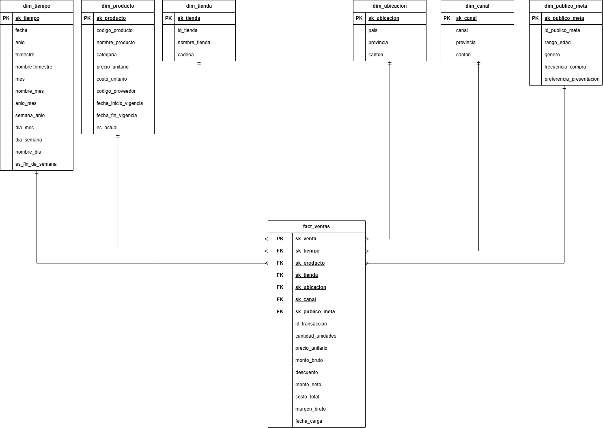

# Proyecto 02 · Solución de Inteligencia de Negocios para Grandpa Panda

Proyecto 2 del curso TI-6900 Inteligencia de Negocios, II Semestre 2026, Escuela de Administración de Tecnología de Información, Instituto Tecnológico de Costa Rica.
Docente Lic. Michael Sánchez Soto.

## La organización

Grandpa Panda es una microempresa familiar costarricense, ubicada en Cartago y fundada en 2016 por Esteban Marcelo Reyes Herrera, su gerente general. Procesa y vende productos de bambú tierno, como el ceviche de bambú y el bambú en vinagre. Maneja su información en hojas de Excel y perdió parte de su historial cuando se dañó una computadora.

## El problema

La empresa no tiene una forma clara de saber en qué zonas y tiendas vende más o menos, cómo se comparan sus ventas entre cadenas y cómo cambian en el tiempo. Los reportes que descarga de la plataforma de Walmart solo traen totales por producto, sin detalle por tienda ni por fecha. Por eso le cuesta decidir dónde reforzar la marca y cómo llegar a su público meta.

El proyecto se enfoca en ventas y mercadeo, como pidió don Esteban en la reunión inicial.

## Preguntas de negocio

1. ¿En qué provincias, zonas o tiendas se registran mayores y menores ventas de Grandpa Panda?
2. ¿Cómo varían las ventas entre las distintas cadenas y canales de venta?
3. ¿Cómo han evolucionado las ventas durante los periodos disponibles y qué tendencias pueden identificarse?
4. ¿Qué oportunidades comerciales pueden identificarse al relacionar las ventas por ubicación con el público meta?
5. ¿Los descuentos aumentan las unidades vendidas lo suficiente para compensar el margen que se pierde? Esta pregunta surgió como hallazgo exploratorio durante el análisis.

## Sobre los datos

La empresa entregó dos reportes descargados de la plataforma de Walmart, que están en `datos/`. El primero (`VENTAS BAMBU.xlsx`, 5 de noviembre) trae unidades vendidas y existencias por producto. El segundo (`ventas.xlsx`, 15 de noviembre) agrega la cantidad de tiendas con ventas y las ventas promedio por tienda. Los dos son totales del periodo, sin detalle por tienda, fecha ni monto.

Para poder construir y probar el modelo dimensional, el detalle por transacción, tienda, fecha y público meta se construyó para el proyecto en `grandapanda_fuente_operacional_limpia_v4.xlsx`. Las tiendas de otras cadenas se incluyeron para probar las comparaciones entre cadenas y canales, y no representan ventas reales de la empresa en esos lugares. Los hallazgos del dashboard muestran lo que la solución puede responder cuando la empresa cuente con datos con ese nivel de detalle.

## Arquitectura de la solución

El flujo va de la fuente operacional en Excel al proceso ETL en Pentaho, que carga un modelo estrella en MySQL, y de ahí al dashboard en Power BI.

```
Excel + CSV de homologación  →  Pentaho Data Integration (8 transformaciones + 1 job)  →  MySQL (modelo estrella)  →  Power BI
```

| Capa | Herramienta | Dónde está |
|---|---|---|
| Fuente operacional | Excel y CSV de homologación | `etl/data/` |
| ETL | Pentaho Data Integration 9.4 (Spoon) | `etl/` |
| Data warehouse | MySQL 8.0 o superior | `base-de-datos/` |
| Solución analítica | Power BI Desktop | `dashboard/` |
| Gestión del trabajo | Scrum adaptado, GitHub y WhatsApp | `documentos/` y `evidencias/` |

El modelo dimensional es un esquema estrella con una tabla de hechos y seis dimensiones.



| Tabla | Contenido |
|---|---|
| `fact_ventas` | Una fila por transacción de venta, con unidades, monto bruto, descuento, monto neto, costo y margen |
| `dim_tiempo` | Calendario 2026 con año, trimestre, mes, semana ISO y día |
| `dim_producto` | Productos y categorías, con historial de cambios de precio y costo (SCD tipo 2) |
| `dim_tienda` | Tiendas y la cadena a la que pertenecen |
| `dim_ubicacion` | País, provincia y cantón |
| `dim_canal` | Supermercado, club de compras o feria |
| `dim_publico_meta` | Rango de edad, género, frecuencia de compra y presentación preferida |

El ETL aplica nueve reglas de transformación, entre ellas la construcción del calendario, la derivación de la cadena, la homologación del cantón, la deduplicación, la validación de calidad, la integridad referencial, el SCD tipo 2 y la conciliación de totales. El detalle está en el informe.

## Integrantes

| Persona | Nombre | Carné | Responsabilidad |
|---|---|---|---|
| 1 | Melody Coto Viera | 2024224269 | Gestión, requerimientos y planificación |
| 2 | Sara Segura González | 2023097391 | Fuente operacional y calidad de datos |
| 3 | Alejandro Peñaranda Soto | 2024800100 | Modelo dimensional y base de datos |
| 4 | Ernesto Cascante Pérez | 2024083177 | Proceso ETL y transformaciones |
| 5 | Tamara Ortega Villalobos | 2023105927 | Dashboard y visualizaciones |
| 6 | Edgar Raúl Barrios Vega | 2024156520 | Análisis, validación y conclusiones |

## Cómo ejecutar la solución

### Requisitos

- MySQL 8.0 o superior, porque la dimensión de tiempo usa una consulta recursiva.
- Pentaho Data Integration 9.4 (Spoon) con el driver JDBC de MySQL en la carpeta `lib`.
- Power BI Desktop.

### Pasos

1. Clonar el repositorio.
   ```bash
   git clone https://github.com/AlejandroPenarandaSoto/proyecto-bi-02-II-semestre-2026.git
   ```
2. Crear la base de datos `dw` y sus tablas.
   ```bash
   mysql -u root -p < base-de-datos/Script_DDL_DW.sql
   ```
3. Abrir `etl/job_carga_dw.kjb` en Spoon.
4. Revisar la conexión `conn_dw_grandpa_panda` (servidor `127.0.0.1`, puerto `3306`, base `dw`, usuario `root`) y poner la contraseña del MySQL local.
5. Ejecutar el job. Las rutas son relativas a la carpeta `etl/`, así que no hay que cambiar ninguna ruta de archivo.
6. Si se quiere, ejecutar `etl/sql/validaciones_dw.sql` para revisar los conteos y totales cargados. Solo hace consultas y no modifica datos.
7. Abrir `dashboard/GrandpaPanda_Dashboard.pbix` en Power BI Desktop y actualizar los datos.

### Qué hace el job

El job carga las tablas en este orden, y si alguna falla se detiene todo.

`dim_tiempo` → `dim_canal` → `dim_ubicacion` → `dim_tienda` → `dim_publico_meta` → `dim_producto` → vacía `fact_ventas` → `fact_ventas` → validación de totales

Al final compara las filas, unidades, monto bruto, descuento y monto neto de la fuente contra lo cargado en `fact_ventas`. Si la diferencia pasa la tolerancia de 0,05, el job termina con error. Se puede ejecutar varias veces sin duplicar datos.

| Medida | Fuente | fact_ventas |
|---|---|---|
| Filas | 180 | 180 |
| Unidades | 7 504 | 7 504 |
| Monto bruto | ₡23 490 530,00 | ₡23 490 530,00 |
| Monto neto | ₡22 448 669,33 | ₡22 448 669,31 |

La diferencia de ₡0,015 en el neto viene del redondeo del descuento a dos decimales en tres ventas.

### Bitácoras

Quedan en `etl/logs/`.

| Archivo | Contenido |
|---|---|
| `bitacora_job_2026-11-22.txt` | Registro completo de una ejecución del job |
| `control_totales.txt` | Resultado de la validación de totales en cada ejecución |
| `control_totales_prueba_falla.txt` | Prueba que demuestra que el job se detiene si los totales no cuadran |
| `rechazos_ventas_calidad.txt` | Filas rechazadas por reglas de calidad. Vacío significa que no hubo rechazos |
| `rechazos_ventas_integridad.txt` | Filas rechazadas por integridad referencial. Vacío significa que no hubo rechazos |

## Estructura del repositorio

```
├── README.md
├── base-de-datos/          Script DDL del data warehouse en MySQL
├── dashboard/              Archivo de Power BI y su tema visual
├── datos/                  Reportes originales de Walmart y fuente operacional del proyecto
├── diagramas/              Diagrama del modelo dimensional y del modelo operacional
├── documentos/             Informe final y presentación
├── etl/                    Transformaciones (.ktr) y job (.kjb) de Pentaho
│   ├── data/               Archivos de entrada del ETL
│   ├── logs/               Bitácoras y controles de cada ejecución
│   └── sql/                Consulta del calendario y validaciones posteriores a la carga
└── evidencias/             Capturas de la ejecución del ETL, del manejo de errores y del SCD tipo 2
    └── levantamiento_requerimientos/  Minuta y transcripción de la reunión inicial, y carta de aceptación firmada
```

## Cronología del proyecto

| Fecha | Qué pasó |
|---|---|
| Domingo 1 de noviembre | Reunión inicial con don Esteban por Microsoft Teams, a las 5 p. m. |
| Jueves 5 de noviembre | Llega el primer reporte de Walmart |
| Domingo 15 de noviembre | Llega el segundo reporte de Walmart |
| Lunes 16 de noviembre | Don Esteban firma la carta de aceptación. Inicia el sprint 1 |
| Jueves 19 de noviembre | Don Esteban envía la carta firmada por correo. Inicia el sprint 2 |
| Viernes 20 de noviembre | El equipo le reenvía la carta al profesor |
| Domingo 22 de noviembre | Inicia el sprint 3 |
| Martes 24 de noviembre | Entrega final a las 5 p. m., fecha aplazada por el profesor desde el 17 de noviembre |
